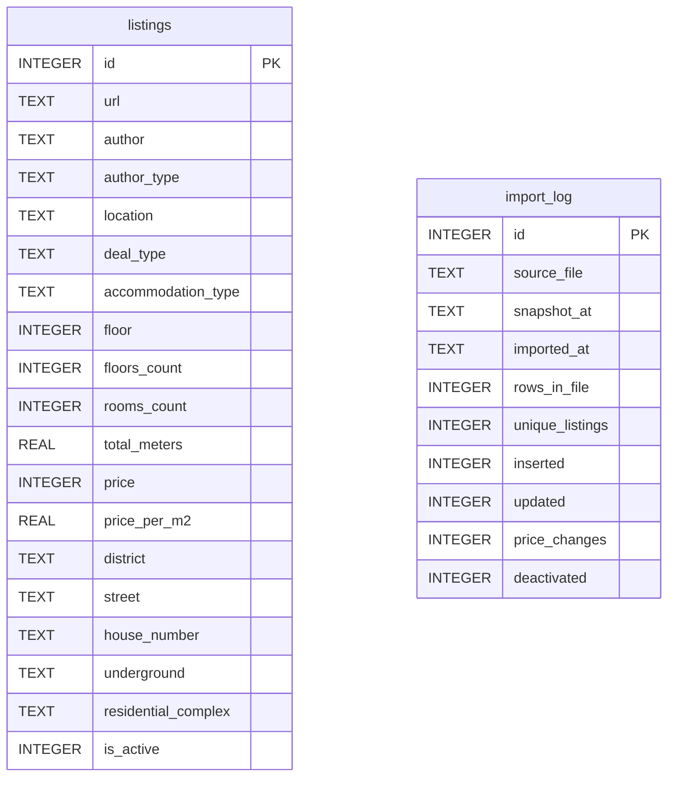

# Лабораторная работа № 1

В ходе выполнения лабораторной работы были собраны и сохранены в БД данные о недвижимости с сервиса Циан. Далее были написаны разлиные запросы для агрегации с помощью модулей pandas и sqlalchemy.

## 1. Сбор данных с Циана 

До начала выполнения работы было принято решение использовать библиотеки requests и bs4 для сбора данных, но, посколько Циан использует мощную защиту от парсинга, которая сразу же блокирвала все запросы, необходимо было найти другое решение задачи. В этом помогла библиотека cianparser, специально разработанная для удобного париснга данных с Циана. При этом и она работала довольно нестабильно. У двух из трех участников команды не получилось загрузить данные. 
Данные были записаны в csv файл.

## 2. Сохранение данных в базу

Ярик пиши я ничего не понимаю.

### Схема базы данных. 

## Схема базы данных

База `cian.db` (SQLite) содержит две таблицы: `listings` с объявлениями и `import_log` с журналом импортов.

#### Таблица `listings` (19 колонок)

| Колонка | Тип | Описание |
|---|---|---|
| id | INTEGER | Первичный ключ |
| url | TEXT | Ссылка на объявление |
| author | TEXT | Автор объявления |
| author_type | TEXT | Тип автора (агентство, собственник и т.д.) |
| location | TEXT | Полный адрес одной строкой |
| deal_type | TEXT | Тип сделки (продажа, аренда) |
| accommodation_type | TEXT | Тип жилья (квартира, апартаменты и т.д.) |
| floor | INTEGER | Этаж |
| floors_count | INTEGER | Этажность дома |
| rooms_count | INTEGER | Количество комнат |
| total_meters | REAL | Общая площадь, м² |
| price | INTEGER | Цена, ₽ |
| price_per_m2 | REAL | Цена за квадратный метр, ₽ |
| district | TEXT | Район |
| street | TEXT | Улица |
| house_number | TEXT | Номер дома |
| underground | TEXT | Станция метро |
| residential_complex | TEXT | Жилой комплекс |
| is_active | INTEGER | Признак актуальности объявления (1 — активно, 0 — снято) |

#### Таблица `import_log` (10 колонок)

| Колонка | Тип | Описание |
|---|---|---|
| id | INTEGER | Первичный ключ |
| source_file | TEXT | Имя исходного файла с данными |
| snapshot_at | TEXT | Дата и время снимка данных |
| imported_at | TEXT | Дата и время импорта в базу |
| rows_in_file | INTEGER | Количество строк в файле |
| unique_listings | INTEGER | Количество уникальных объявлений |
| inserted | INTEGER | Сколько объявлений добавлено |
| updated | INTEGER | Сколько объявлений обновлено |
| price_changes | INTEGER | У скольких объявлений изменилась цена |
| deactivated | INTEGER | Сколько объявлений помечено неактивными |

Таблицы между собой внешними ключами не связаны.
## 3. Запросы к базе данных
Запросы были написаны с помощью модулей sqlalchemy и pandas. Для удобства работы все запросы были выполены в Colab. 

